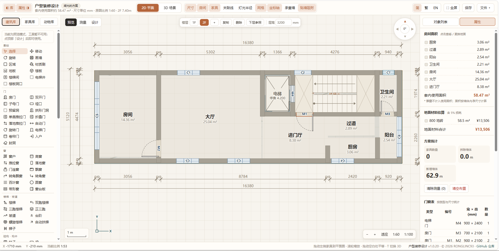
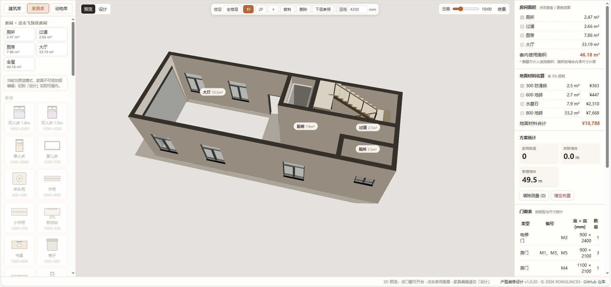
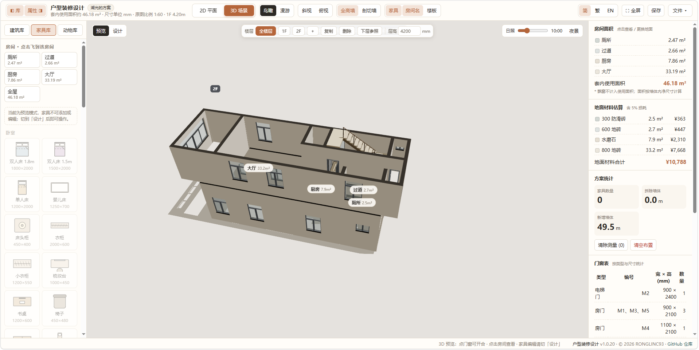
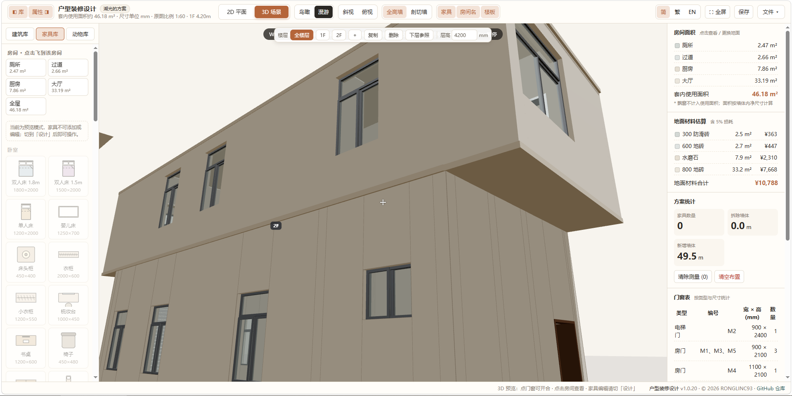
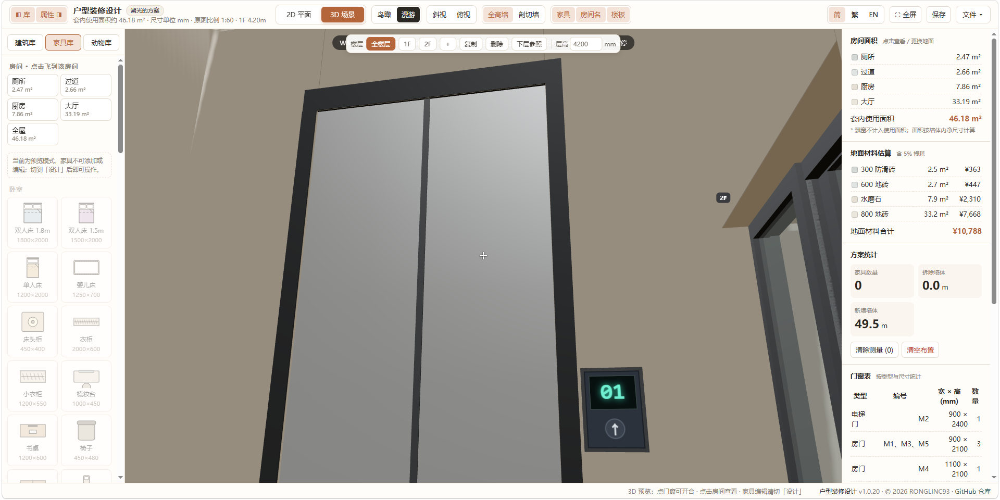
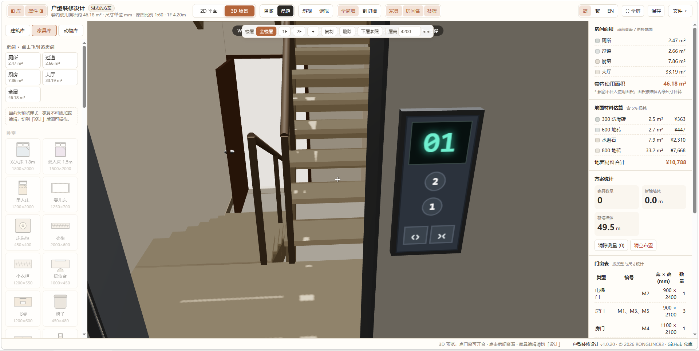

# Floor Plan Interior Designer

[中文](README.md) | English

A pure front-end tool for interior design on a floor plan: place furniture, remove or modify walls, and take measurements on a 2D plan, then switch to a Three.js 3D scene with one click — view it from above or walk through it in first person. 

> **Disclaimer: this program is a fork of an open-source project, developed for learning purposes only. It must not be used for any commercial purpose.**

## Screenshots

**2D floor plan design**: draw walls / doors & windows / columns / stairs, with live dimensions and area labels



**3D bird's-eye and cutaway**: switch between full-height and cutaway walls, and view all floors at once

| 3D bird's-eye (single floor) | All floors, cutaway view |
| --- | --- |
|  |  |

**3D walkthrough and elevator**: first-person walk (WASD / virtual joystick) with clickable doors; elevator call buttons, in-car floor selection, automatic door operation on arrival

| 3D walkthrough (exterior) | Elevator door call panel (glowing floor display) |
| --- | --- |
|  |  |

Multiple floor buttons in the car can be lit and queued; stops are served in the direction of travel:



## Features

**2D Floor Plan**
- Displays the original floor plan at 1:60 / 1:100 scale, dimensions in mm; the plan can be rotated as a whole
- Drag 60+ furniture and appliance items from the library on the left (bedroom, living room, dining & kitchen, bathroom, appliances, study & leisure)
- Move, rotate (hold Shift for free angle), and resize items, with automatic snapping to walls; arrow keys nudge, Ctrl+A selects all
- Preview mode (V) is read-only: pan / wheel zoom, click a room to see its area and change flooring
- **Design mode (X / W)**: draw walls (snaps to 0°/90°/45°, fuses onto existing walls, or type a length after clicking the start point), draw rectangular rooms, place doors & windows (door, pass-through, double door, parent-child door, roller shutter, elevator door, floor-to-ceiling window, sliding floor-to-ceiling window, window, tall window, door-with-window), columns, stairs (single / double / three-run / U-shaped), and set the unique entry door; marquee multi-select, Ctrl+D to duplicate
- Measuring tool (M, snaps to nearby walls; hold Shift to lock horizontal / vertical)
- Non-load-bearing walls can be marked for demolition (and restored); load-bearing walls are protected and marked separately
- Layer toggles: dimensions, room names, furniture, grid, load-bearing walls

**3D Scene**
- Bird's-eye, oblique, and top-down views; click a room in the list to fly to it
- Walkthrough mode: WASD + mouse on desktop, virtual joystick on touch devices; click doors to open / close them
- Toggle between full-height and cut-away walls, time-of-day sunlight slider, night lighting
- Detailed furniture models: cabinet door gaps and handles, upholstered headboards, metal and ceramic materials with environment reflections, and more
- Select and drag furniture in 3D as well, kept in sync with the 2D plan in real time

**Multi-Floor & Slabs**
- Floor bar on top of the canvas: switch between 1F / 2F / all floors; each floor's height is editable (1200–12000mm); add floors or duplicate an entire floor
- New building tools "Slab" and "Floor": click two diagonal corners to define an area; stairwells and elevator shafts are punched through automatically
- Lower-floor ghost walls: from 2F up, the walls of the floor below are shown semi-transparent in both 2D and 3D, with a one-click toggle
- Marquee-selected objects can be copied / moved across floors (target floor picker in the panel)
- "All floors" walkthrough lets you move between levels via stairs and elevators; rooms without a custom style on other floors get an automatic slab, so the whole building is walkable with no floating

**Elevator System**
- The "Elevator" tool: shaft with configurable floor count and per-floor stop heights; the car rises with the current floor
- Car control panel beside the door: floor buttons light up and queue (multi-select); the lift stops in travel order and opens / closes doors automatically; tapping an already-passed floor blinks once and is ignored
- The "Elevator door" opening (Building tools): link it to an elevator and set its floor; the call button beside the door (with a glowing floor display) summons the car to that level
- Doors auto-close 6 seconds after opening; a light-curtain keeps them open when someone (or a pet) is in the doorway, and they reverse instantly if blocked while closing

**Site & Roads**
- New "Roads" group in Building tools: highway, road, city road, country road, footpath and sidewalk — click a start and end point (orthogonal / free mode, hold Shift to temporarily lock the axis)
- 2D shows the pavement, curbs, dashed lane lines / double yellow center / median / paving joints by type; 3D builds a solid road surface with markings that stays walkable in roaming mode
- End handles resize the road; the panel switches road type, edits "lanes per direction" (1-8; width is computed as lanes × lane width + median + shoulders), road width and pavement thickness; marquee selection, duplicate, delete, undo and per-floor storage are supported
- Building tool "Street lamp": click to place; switch between single-arm / double-arm / courtyard / high-mast lamps; 2D plan shows the base, arm and head, 3D builds a tapered pole with a glowing head (only the pole base blocks walking, the head is overhead). Switchable on/off: click the pole in 3D or use the panel checkbox; switching to night mode automatically turns lamps back on and lights the surroundings (they can still be switched off manually at night; by day only the head glows); the panel edits pole diameter, height, arm length, angle and light radius, with marquee selection, duplicate, delete, undo and per-floor storage
- Building tool "Solar street lamp": has a tilted roof panel, blinking red indicator and a battery bar on the pole. It charges by day, switches on automatically and drains the battery at night, and switches off when empty (manual on is blocked until recharged). Click the pole in 3D to toggle; the panel edits battery level, charge / drain rates and dimensions. The 2D plan shows the panel, battery percentage and blinking red dot

**Plans & Statistics**
- Automatic calculation of room areas and net usable floor area
- Change the floor material of each room (wood, tiles, marble, terrazzo, carpet, etc.), with cost estimates based on area plus 5% wastage
- Undo / redo; plans are auto-saved
- Chinese / English UI toggle (button on the right of the top bar; defaults to Chinese and remembers your choice)
- Export to PNG, export / import plans as JSON

## New Features in This Fork

The following features are all added on top of the original project (which is a single `index.html` with CDN dependencies):

- **Python local server** (`app.py`, FastAPI): hosts the web UI so any device on the same network — phones, tablets, computers — can access it from a browser (`http://<your-ip>:8765`)
- **Server-side plan storage**: plans are saved as JSON in the server's `plans/` directory with save / open / delete support, plus automatic saving to the server (`autosave.json`); writes use "temp file + atomic replace" to prevent corruption. Plans no longer rely only on browser localStorage and survive device changes
- **Fully localized dependencies**: Three.js and the icon library are now loaded from the local `libs/` directory instead of the jsDelivr CDN — **all features work offline**
- **One-click launch**: on Windows, double-click `启动服务器.bat` to automatically check and install Python dependencies, then start the server
- **Mobile support**: on phones / small tablets (≤820px) the top bar collapses into an "⋯ Tools" menu and the side panels become drawers with a mask; floating widgets are re-staggered to avoid overlap, touch targets are enlarged, and wall-length input gains an "Apply" button

## Quick Start

### Option 1: Python local server (recommended — multi-device access, server-side plans)

On Windows, just double-click `启动服务器.bat` (dependencies install automatically on first run), or run manually:

```bash
pip install -r requirements.txt
python app.py
```

The browser opens `http://localhost:8765` automatically; other devices on the same network can visit `http://<your-ip>:8765`.

### Option 2: Pure front-end

Simply open `index.html` in your browser — but plans can then only be saved in the browser's local storage. Alternatively, start a local static server:

```bash
python3 -m http.server 8000
# Visit http://localhost:8000
```

> Three.js and other dependencies are bundled locally in the `libs/` directory — all features work without an internet connection.

## Keyboard Shortcuts

| Key | Action |
| --- | --- |
| `T` | Toggle 2D / 3D |
| `V` / `M` / `X` / `W` | Preview / Measure / Design (edit) / Design + draw walls |
| `R` / `Shift+R` | Rotate selected furniture 90° clockwise / counterclockwise |
| Arrow keys | Nudge selected furniture (Shift = faster) |
| `Delete` / `Backspace` | Delete selected object (Design mode only) |
| `Ctrl/⌘ + D` | Duplicate selected object |
| `Ctrl/⌘ + A` | Select all |
| `Ctrl/⌘ + Z`, `Ctrl/⌘ + Shift + Z` (or `Ctrl/⌘ + Y`) | Undo, redo |
| `F` | Fit to window |
| `+` / `-` | Zoom in / out |
| `[` / `]` | Show / hide the furniture library (left) and the side panel (right) |
| `Shift + F` | Fullscreen |
| `Esc` | Cancel current action |
| Walkthrough: `WASD` / arrow keys, `Shift`, `E`, `Space` | Move, walk faster, open / close doors, jump |

## Tech Stack

- Vanilla HTML / CSS / JavaScript — no framework, no build step
- 2D floor plan rendered with SVG
- 3D scene built with [Three.js](https://threejs.org/) r160 (OrbitControls, PointerLockControls, RoundedBoxGeometry, RoomEnvironment, CSS2DRenderer)
- Local server: Python + FastAPI / Uvicorn (`app.py`)

## Design Patterns & Architecture

Although the whole app lives in a single `index.html` file, its internals are organized into 30+ module sections marked by comments (state & history, geometry utilities, rendering, pointer interaction, keyboard, furniture library, 2D/3D switching, 3D scene, walkthrough, main loop, etc.), using the following design patterns and architecture ideas:

- **Centralized state management**: plan data (`state`) and UI state (`ui` — current tool, selection, layer toggles) are strictly separated; `state` is the single source of truth shared by both the 2D SVG view and the Three.js 3D scene, with real-time sync in both directions
- **Memento pattern (undo / redo)**: all modifications go through a single `mutate()` entry point, which snapshots `state` as JSON into `undoStack` before applying (capped at 150 steps); undo / redo simply pop snapshots
- **Multi-level mode state machine**: the 2D view has three main modes — Preview (`V`), Measure (`M`), Design (`X` / `W`); Design mode further splits into sub-tools (select & edit, draw walls, doors & windows, columns, stairs, etc.) tracked by a two-level `ui.tool` / `ui.drawTool` state machine, with pointer and keyboard events dispatched by the current mode
- **View separation (2D/3D dual renderers)**: the 2D plan is rendered with SVG and the 3D scene with Three.js — neither depends on the other, communicating only through `state`; one keypress (`T`) switches between them
- **Debounced auto-save**: every modification triggers a debounced auto-save, persisting the plan to the server (`autosave.json`) to avoid high-frequency writes
- **Data-driven configuration**: `ROOMS` / `WALLS` / `WINS` / `MATS` / `LIB` are declarative data tables — swap in your own floor plan or furniture library by editing data only, no logic changes needed
- **i18n dictionary**: a `LANGS` Chinese/English dictionary with a `tr()` lookup function provides refresh-free UI language switching

## Project Structure

```
index.html          Main program (all 2D / 3D logic in a single file)
libs/               Local Three.js and other dependency libraries
app.py              Python local server (web hosting + plan storage API)
plans/              Plans saved on the server (JSON)
启动服务器.bat       One-click launch script for Windows
requirements.txt    Python dependencies
push.py             Git push script (python push.py [commit message])
pull.py             Git pull script (python pull.py, rebase-based)
pack_fpk.py         fnOS (飞牛 NAS) app packaging script (python pack_fpk.py [version], produces a .fpk installer)
```

## Customizing the Floor Plan

The floor plan data lives in `index.html`:

- `ROOMS`: room polygons, names, and default floor materials
- `WALLS` / `WINS`: walls and window openings
- `MATS`: floor material names and unit prices
- `LIB`: furniture library (type, name, default size, color)
- `buildFurniture()`: 3D models for each furniture type

Edit this data to use your own floor plan.

## Developer & Credits

This project is a fork of the open-source project [wy51ai/floorplan-3d](https://github.com/wy51ai/floorplan-3d). Thanks to the original author wuyi (X: [@akokoi1](https://x.com/akokoi1)) for the original work.

Maintainer of this fork: **RONGLINC93** (GitHub: [RONGLINC93](https://github.com/RONGLINC93)), who added the Python local server, server-side plan storage, and fully localized (offline-capable) dependencies — see "New Features in This Fork" above.

## License

[MIT](LICENSE) (for learning purposes only — not for commercial use)
