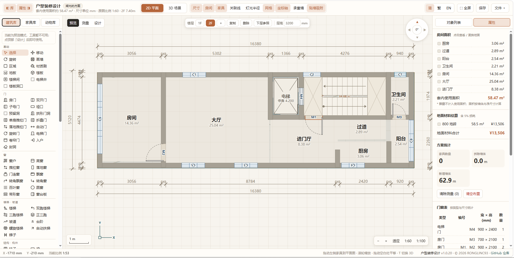
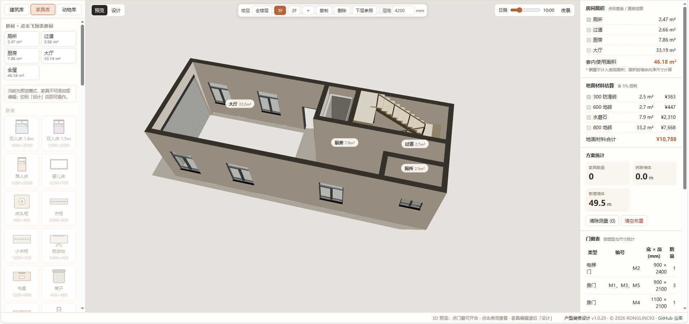
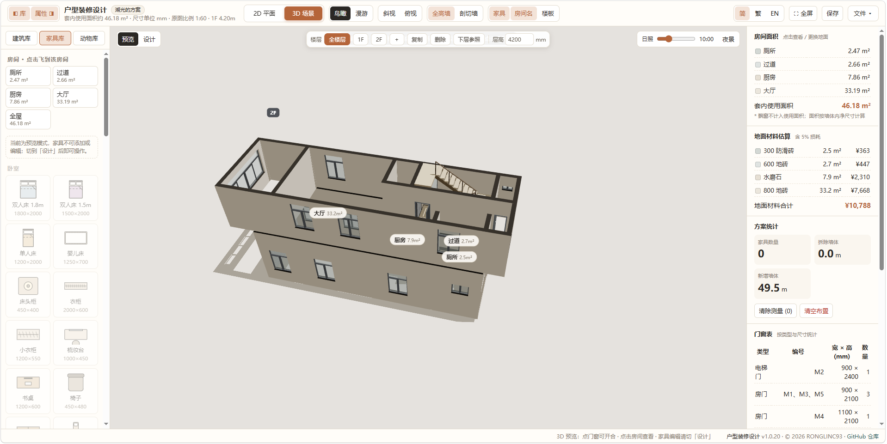
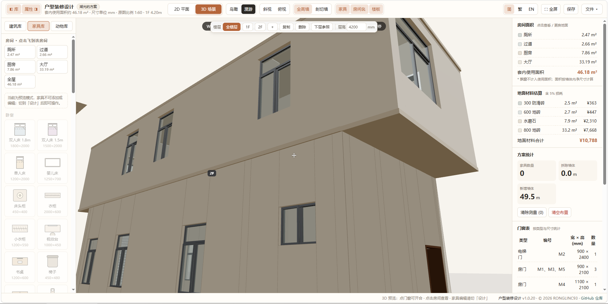
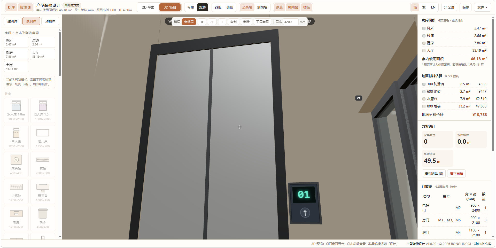
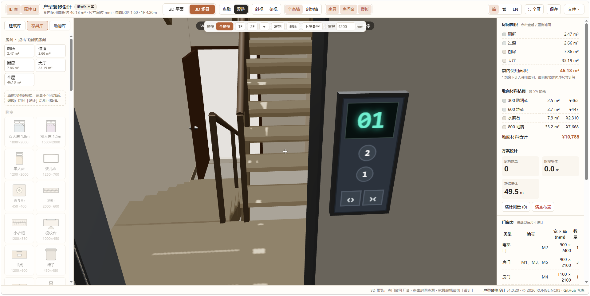

# 户型装修设计

中文 | [English](README.en.md)

纯前端的户型装修设计工具：在 2D 平面图上摆放家具、拆改墙体、测量尺寸，一键切换到 Three.js 3D 场景，可以鸟瞰，也可以第一人称漫游。

> **声明：本程序基于开源项目二次开发，仅供学习交流使用，请勿用于任何商业用途。**

## 界面预览

**2D 平面设计**：画墙 / 门窗 / 柱子 / 楼梯，尺寸与面积实时标注



**3D 鸟瞰与剖切**：全高墙 / 剖切墙切换，支持全楼层同屏查看

| 3D 鸟瞰（单层） | 全楼层剖切 |
| --- | --- |
|  |  |

**3D 漫游与电梯**：第一人称漫游（WASD / 虚拟摇杆），可点门开关；电梯门呼梯、轿厢内选层、到站自动开门

| 3D 漫游（建筑外观） | 电梯门呼梯（发光楼层显示屏） |
| --- | --- |
|  |  |

电梯轿厢内楼层按钮可多选排队亮灯，按运行方向顺向依次停靠：



## 功能

**2D 平面布置**
- 按原始户型 1:60 / 1:100 比例显示，尺寸单位 mm，平面可整体旋转
- 从左侧家具库拖入 60 余种家具家电（卧室、客厅、餐厨、卫浴、家电、书房休闲）
- 拖动移动、旋转（Shift 自由角度）、调整尺寸，贴墙自动吸附；方向键微调，Ctrl+A 全选
- 预览模式（V）只读浏览：拖动平移 / 滚轮缩放，点击房间查看面积与更换地面
- **设计模式（X / W）**：画墙（吸附 0°/90°/45°，靠近旧墙自动融合，可点起点后直接输入长度回车）、绘制矩形房间、布置门窗（房门 / 垭口 / 双开门 / 子母门 / 卷帘门 / 电梯门 / 落地窗 / 落地推拉门 / 窗户 / 高窗 / 门连窗）、柱子、楼梯（直跑 / 双跑 / 三跑 / 正三跑）、设置唯一入户门；框选批量操作，Ctrl+D 复制
- 测量工具（M，靠近墙面自动吸附，Shift 锁定水平 / 垂直）
- 拆改非承重墙（标记拆除、可恢复），承重墙不可拆除并单独标示
- 图层开关：尺寸标注、房间名、家具、网格、承重墙

**3D 场景**
- 鸟瞰、斜视、俯视多种视角，点击房间列表可飞到对应房间
- 漫游模式：桌面端 WASD + 鼠标，触屏设备用虚拟摇杆，可以点门开关
- 全高墙 / 剖切墙切换，日照时间滑块，夜景灯光
- 精细家具模型：柜门分缝与拉手、软包床头、带环境反射的金属与陶瓷材质等
- 在 3D 中也能选中、拖动家具，与 2D 方案实时同步

**多楼层与楼板**
- 画板顶部楼层条：切换 1F / 2F / 全楼层，每层层高可单独设置（1200–12000mm），可新增楼层、整层复制
- 建筑工具新增「楼板」与「地板」：两次点击对角点定义一块楼面区域；楼梯间、电梯井等洞口自动镂空
- 下层参照：切到 2F 起，2D 与 3D 都以半透明灰色显示紧邻下层的墙体，可一键开关
- 框选对象跨楼层复制 / 移动（右侧面板选择目标楼层）
- 「全楼层」漫游可在各层之间经楼梯、电梯上下；其它楼层无样式的房间自动生成楼板，整栋漫游有完整支撑、不会悬空

**电梯系统**
- 「电梯」工具：井道可设楼层数与各层停靠高度，轿厢随当前楼层升降
- 轿厢内门旁控制面板：楼层按钮可多选亮灯排队，电梯按运行方向顺向依次停靠、到站自动开关门；运行中按已过掉的楼层亮灯一下即灭、不会折返
- 建筑工具「电梯门」门洞：选择联动的电梯、设置所在楼层，门侧呼叫按钮（带发光楼层显示屏）一键呼梯到该层
- 电梯门开门 6 秒后自动关门；门口有人或动物时光幕防夹保持开启，关门途中被挡立即反向重开

**方案与统计**
- 房间面积与套内使用面积自动统计
- 为每个房间更换地面材料（木地板、地砖、大理石、水磨石、地毯等），按面积加 5% 损耗估算造价
- 撤销 / 重做，方案自动保存
- 中文 / English 界面切换（顶栏右侧按钮，默认中文，选择会记住）
- 导出 PNG 图片，导出 / 导入方案 JSON

## 二次开发新增功能

以下功能均为在原版基础上新增（原版仅一个 `index.html`，依赖 CDN）：

- **Python 本地服务器**（`app.py`，FastAPI）：托管网页界面，同一局域网内手机 / 平板 / 电脑等任何设备浏览器均可访问（`http://<本机IP>:8765`）
- **服务器端方案存储**：方案以 JSON 保存到服务器 `plans/` 目录，支持保存 / 打开 / 删除，并自动保存到服务器（`自动保存.json`）；写入采用「临时文件 + 原子替换」，避免写一半损坏。方案不再只存浏览器 localStorage，换设备不丢失
- **依赖库完全本地化**：Three.js、图标库由 jsDelivr CDN 加载改为随 `libs/` 目录本地加载，**断网也能使用全部功能**
- **一键启动**：Windows 双击 `启动服务器.bat`，自动检测并安装 Python 依赖后启动服务器
- **移动端适配**：手机 / 小平板（≤820px）顶栏自动收纳为「⋯ 工具」，左右面板作为抽屉弹出、点遮罩或关闭按钮收起；画板浮件错层排布避免互相遮挡，触控目标加大，画墙长度新增「应用」按钮，输入框与弹窗适配小屏

## 快速开始

### 方式一：Python 本地服务器（推荐，支持多设备访问与服务器存方案）

Windows 直接双击 `启动服务器.bat`（首次运行会自动安装依赖），或手动执行：

```bash
pip install -r requirements.txt
python app.py
```

启动后自动打开浏览器访问 `http://localhost:8765`；同一局域网内的其他设备访问 `http://<本机IP>:8765` 即可。

### 方式二：纯前端直接打开

直接用浏览器打开 `index.html` 也可以使用，但方案只能保存在浏览器本地。也可以起一个本地静态服务器：

```bash
python3 -m http.server 8000
# 访问 http://localhost:8000
```

> Three.js 等依赖库已随 `libs/` 目录本地化，无需联网即可使用全部功能。

## 快捷键

| 按键 | 作用 |
| --- | --- |
| `T` | 切换 2D / 3D |
| `V` / `M` / `X` / `W` | 预览 / 测量 / 设计（编辑） / 设计 + 画墙 |
| `R` / `Shift+R` | 选中家具顺时针 / 逆时针旋转 90° |
| 方向键 | 微移选中家具（Shift 加速） |
| `Delete` / `Backspace` | 删除选中对象（仅设计模式） |
| `Ctrl/⌘ + D` | 复制选中对象 |
| `Ctrl/⌘ + A` | 全选 |
| `Ctrl/⌘ + Z`，`Ctrl/⌘ + Shift + Z`（或 `Ctrl/⌘ + Y`） | 撤销，重做 |
| `F` | 适应窗口 |
| `+` / `-` | 放大 / 缩小 |
| `[` / `]` | 展开 / 收起左侧家具库、右侧面板 |
| `Shift + F` | 全屏 |
| `Esc` | 取消当前操作 |
| 漫游：`WASD` / 方向键，`Shift`，`E`，`空格` | 移动，快走，开关门，跳跃 |

## 技术栈

- 原生 HTML / CSS / JavaScript，无框架、无构建步骤
- 2D 平面图用 SVG 绘制
- 3D 场景用 [Three.js](https://threejs.org/) r160（OrbitControls、PointerLockControls、RoundedBoxGeometry、RoomEnvironment、CSS2DRenderer）
- 本地服务器用 Python + FastAPI / Uvicorn（`app.py`）

## 设计模式与代码架构

整个应用虽然集中在 `index.html` 一个文件里，但内部按注释划分为 30 余个模块区块（状态/历史、几何工具、渲染、指针交互、键盘、家具库、2D/3D 切换、3D 场景、漫游、主循环等），并运用了以下设计模式与架构思路：

- **集中状态管理**：方案数据 `state` 与界面状态 `ui`（当前工具、选中项、图层开关）严格分离；`state` 是唯一数据源，2D 与 3D 共享同一份 `state`，任意一端修改后实时同步渲染
- **备忘录模式（撤销 / 重做）**：所有修改统一经由 `mutate()` 入口，修改前对 `state` 拍 JSON 快照压入 `undoStack`（上限 150 步），撤销 / 重做即快照出入栈
- **多级模式状态机**：2D 端分为预览（`V`）、测量（`M`）、设计（`X` / `W`）三种主模式，设计模式下再细分子工具（选择编辑、画墙、门窗、柱子、楼梯等），由 `ui.tool` / `ui.drawTool` 两级状态构成状态机，指针与键盘事件按当前模式统一分发
- **视图分离（2D/3D 双渲染器）**：2D 平面图用 SVG 渲染，3D 场景用 Three.js 渲染，二者互不依赖、仅通过 `state` 通信；`T` 键一键切换
- **防抖自动保存**：每次修改触发防抖的自动保存，方案持久化到服务器（`自动保存.json`），避免高频写入
- **数据驱动配置**：`ROOMS` / `WALLS` / `WINS` / `MATS` / `LIB` 均为声明式数据表，改数据即可换户型、换家具库，无需动逻辑代码
- **多语言字典**：`LANGS` 中英文词条表 + `tr()` 查表翻译，界面切换无刷新

## 项目结构

```
index.html          主程序（2D / 3D 全部逻辑，单文件）
libs/               本地 Three.js 等依赖库
app.py              Python 本地服务器（网页托管 + 方案存取 API）
plans/              服务器端保存的方案 JSON
启动服务器.bat       Windows 一键启动脚本
requirements.txt    Python 依赖
push.py             Git 推送脚本（python push.py [提交说明]）
pull.py             Git 拉取脚本（python pull.py，rebase 方式）
pack_fpk.py         飞牛 fnOS 应用打包脚本（python pack_fpk.py [版本号]，生成 .fpk 安装包）
```

## 自定义户型

户型数据写在 `index.html` 里：

- `ROOMS`：房间多边形、名称、默认地面材料
- `WALLS` / `WINS`：墙体与窗洞
- `MATS`：地面材料名称与单价
- `LIB`：家具库（类型、名称、默认尺寸、颜色）
- `buildFurniture()`：各类家具的 3D 模型

改这些数据就能换成自己的户型。

## 开发者与致谢

本项目基于开源项目 [wy51ai/floorplan-3d](https://github.com/wy51ai/floorplan-3d) 二次开发，感谢原作者 wuyi（X：[@akokoi1](https://x.com/akokoi1)）的开源贡献。

二次开发维护者：**RONGLINC93**（GitHub：[RONGLINC93](https://github.com/RONGLINC93)），在原版基础上新增了 Python 本地服务器、服务器端方案存储、依赖库本地化（离线可用）等功能，详见上方「二次开发新增功能」。

## 许可协议

[MIT](LICENSE)（本项目仅供学习交流使用，请勿用于商业用途）
